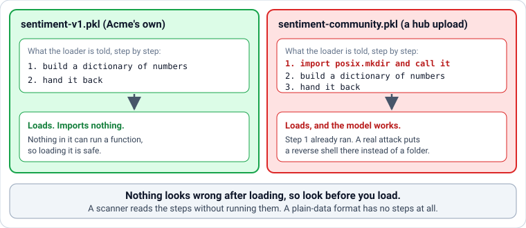

# Chapter 9: AI supply chain: malicious model files, look-alike packages and dependency risks

An AI system is built from things somebody else made: a model file, packages, a base image, data. Every one of them runs on your machine, often before any of your own code does. This chapter is about **trusting what you download** (OWASP LLM04, Supply Chain).

You run nothing in this chapter. Read it, then try it in [Lab 9.1](lab-9-1-model-files-and-packages.md), read the fixes in [Lab 9.2](lab-9-2-fixes.md), and run the real model scanners in [Lab 9.3](lab-9-3-scan-with-real-tools.md).

**Time:** about 15 minutes. **Cost:** nothing.

## 9.1 A model file is a program

A colleague found a better sentiment model on a public hub and downloads `sentiment-community.pkl`. The `.pkl` means **pickle**, Python's standard way of saving objects. Here is the problem: a pickle is not a table of numbers. It is a **list of steps for the loader to follow**, and one of the steps can be "import this function and call it".



Loading the community file the usual way, in the lab:

```
Load (risky way): sentiment-community.pkl
  loaded, and the model works: acme-sentiment v1.0, 8 weights
  BUT code ran on your machine: the loader created the folder /tmp/bdai-proof-of-code-execution
```

The model works, the scores look right, and nothing warns you. In the lab the extra step only makes an empty folder. **Real attacks use the same step to open a shell back to the attacker.**

!!! note "A real case"
    In early 2024 the security firm JFrog reported about 100 models on Hugging Face that carried real harmful payloads, most of them in pickle-based files. One, uploaded by a new account, used the pickle mechanism to open a reverse shell to an outside address. Hugging Face marks pickle files it finds suspicious, but it does not block downloading them.

## 9.2 Reading a file without running it

You do not need a special tool to find out what a pickle will do. Python ships one that prints its steps, one per line, without running any of them:

```
python -m pickletools sentiment-community.pkl

    0: \x80 PROTO      2
    2: c    GLOBAL     'posix mkdir'          <- import a function by name
   15: X    BINUNICODE '/tmp/bdai-proof-of-code-execution'
   53: \x85 TUPLE1
   54: R    REDUCE                            <- call it with that argument
   55: 0    POP
   56: }    EMPTY_DICT                        <- ...and now build the model as if nothing happened
   ...
```

Reading it takes a minute. `GLOBAL` (or `STACK_GLOBAL`) imports something by name, and `REDUCE` calls it. The clean file has neither: it only builds a dictionary of numbers. That is the skill: **look at the steps before you load**.

Real teams do not read every file by hand, so they use scanners. Three are widely used, and they work differently:

| Tool | What it does |
|---|---|
| **picklescan** | Walks the steps and flags imports on a list of dangerous or suspicious functions. Hugging Face runs a scanner of this kind on uploads. |
| **modelscan** (Protect AI) | The same idea across several model formats, with a severity for each finding. |
| **fickling** (Trail of Bits) | Turns the pickle back into readable Python, and can check it for safety. |

You run all three on the lab's files in [Lab 9.3](lab-9-3-scan-with-real-tools.md), and they do **not** always agree. Most work from a list of functions known to be bad, so a scanner can miss a payload built from something not on the list, and can flag harmless code. A published analysis by JFrog found that a large share of the Hugging Face models flagged unsafe by pickle scanning were false positives, and researchers have shown pickles that slipped past two popular scanners until they were patched. Treat a scan as "not obviously bad", never as "safe".

The stronger fix is a **format that cannot hold steps at all**. `sentiment-v1.json` is the same eight numbers as plain data, and `safetensors` is the same idea for real model weights. The lab's safe loader refuses any pickle that wants to import anything:

```
Load (safe way): sentiment-community.pkl
  refused: this file asks to import posix.mkdir, so it was not loaded
```

Note that PyTorch changed its own loader in version 2.6 so that `torch.load` only reads plain weights by default (`weights_only=True`). That helps, but older code, other loaders and files in other formats do not all have that protection.

## 9.3 Packages: the name is the attack

The same trust problem sits in `pip install`. Here is Acme's package list, with the problems a reviewer would stop:

```
numpy                      no version: tomorrow's install can differ from today's
reqeusts==2.31.0           one swapped letter from "requests": a typosquat
python-dateutils==2.8.2    one extra letter from "python-dateutil": a typosquat
fast-tokenizer-pro==0.4.1  not on anyone's approved list
git+https://github.com/unknown-user/tokenizer-fork.git     code nobody reviewed, which can change
--extra-index-url https://packages.acme-internal.example/simple   a second server to ask
```

- A **typosquat** waits for a typing mistake. So does an AI that invents a name (Chapter 7).
- A **second package index** lets an installer pick whichever server offers the *higher version*. An attacker who publishes a look-alike of an internal package name on the public index with a big version number can win. This is called dependency confusion.
- A package that is **pinned but without a hash** can still be swapped on the server. A hash is a fingerprint of the exact file.

!!! note "A real case"
    On 24 March 2026, versions 1.82.7 and 1.82.8 of `litellm`, a widely used Python package for calling AI models, were published to PyPI by an attacker who had taken over a maintainer's credentials. The malicious versions stole cloud and other credentials, and the second one ran as soon as Python started, without the package being imported. PyPI removed them within hours (reports differ on how long exactly). Anyone whose package list said `litellm` with no pinned version, and who installed in that window, was affected. People with an exact version and a hash were not.

## 9.4 The locks

- **Prefer formats that cannot hold code.** safetensors and JSON for weights. If you must load a pickle, only from a source you trust, and read it first.
- **Pin exact versions with hashes** (`pip install --require-hashes`), so only the files you reviewed install, and so a new release does not arrive on its own.
- **Keep an approved list** and make a new name a review, not an accident.
- **One package index.** Put internal packages under names nobody can claim on the public index, or serve everything from your own mirror.
- **Install in a place that can be thrown away:** no secrets, no network you do not need, no access to production.

??? note "Going deeper (optional): the standards"
    In the OWASP Top 10 for LLM Applications (2026), this chapter is LLM04 Supply Chain. A software bill of materials (SBOM) lists what a build contains, and some teams now keep an **AI bill of materials** that also lists models, datasets and their sources. Chapter 10 covers where this fits in governance.

    The audit in the lab is a short rule list: typo distance from approved names, missing pins, missing hashes, second indexes and direct URLs. Real tools check a package's age, owners and known vulnerabilities as well, and a scanner for model files checks many more ways of hiding code than the single import the lab shows.

    Docker base images and GitHub Actions are part of the same chain, and so are the tools that scan your code. The LiteLLM incident is reported to have started with a compromised security scanner in a build pipeline. Pinning by digest or hash applies to them too.

## Key takeaways

- A **pickle model file is a program**. Loading it can run code, and nothing looks wrong afterwards.
- **Read before you load** (pickletools, then a real scanner), and prefer formats with no steps in them (safetensors, JSON).
- A package **name** can be an attack: typosquats, invented names, a second index.
- **Pin exact versions with hashes** and keep an approved list.
- The thing you trust may itself be built from things you do not control: build tools, base images, scanners.

## Check yourself

??? question "1. The community model loaded and its scores were fine. Does that mean it was safe?"
    No. The extra step in the file runs while it loads, before any score exists, and the model still works afterwards. Working correctly proves nothing about what else the file did.

??? question "2. Why is a JSON model safer than a pickle model?"
    JSON is plain data. Reading it can only produce numbers, text and lists. A pickle is a list of steps for the loader, and a step can import and call any function.

??? question "3. A package list says `requests==2.31.0` with no hash. What can still go wrong?"
    The version is pinned, but nothing checks that the downloaded file is the one you reviewed. If the file on the server is replaced, or an installer is pointed at another server, the wrong file installs. A hash pins the exact file.

## What's next

Do [Lab 9.1](lab-9-1-model-files-and-packages.md) to read, load and audit, read [Lab 9.2](lab-9-2-fixes.md), then run the real scanners in [Lab 9.3](lab-9-3-scan-with-real-tools.md). Chapter 10 steps back to threat modeling and governance: how a team decides which of all these risks to deal with first.
