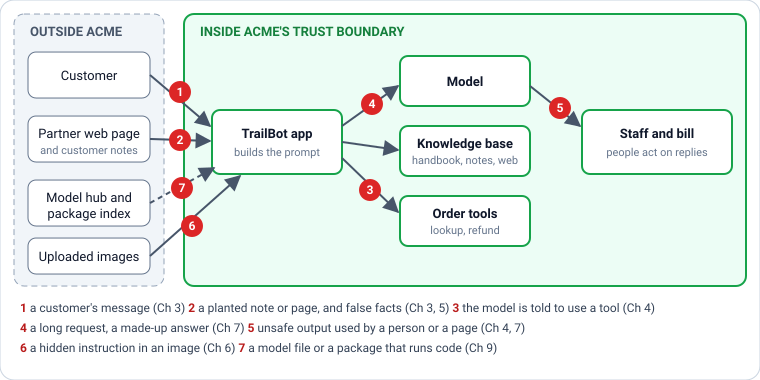

# Chapter 10: Threat modeling and governance: deciding what to fix first, and who is accountable

You have now broken TrailBot in a dozen ways. A real team cannot fix a dozen things at once and cannot guess which matter. This chapter is about **deciding**: a short method for finding the threats (threat modeling), and the paperwork around it (governance), which includes the frameworks and laws you will be asked about.

There is no lab. You do it on paper, for TrailBot, in about 20 minutes. The template is below.

**Time:** about 20 minutes. **Cost:** nothing.

## 10.1 Four questions

Threat modeling is four questions, asked in this order:

1. **What are we building?** Draw it.
2. **What can go wrong?** Walk the drawing and list the threats.
3. **What are we going to do about it?** A fix, a monitor, or a decision to accept it.
4. **Did we do a good enough job?** Test it, as in Chapter 8.

### Question 1: draw it, and mark where trust changes

Everything on the left of the dashed line is **outside Acme's control**: customers, partner pages, images, the model hub, the package index. Every arrow that **crosses the line** carries something an attacker may have written. That is where to look first.

In an AI system the important thing to notice is that **the model reads all of it as one stream of text**. A planted note (2) crosses the line the same way a customer's message (1) does, even though a note never looks like a customer message.

### Question 2: what can go wrong, at each arrow

For each arrow ask the six STRIDE questions. Here they are for an AI app, with the chapter where you met each:

| STRIDE | The question | In TrailBot |
|---|---|---|
| **S**poofing | Can someone pretend to be someone else? | A refund request for another customer's order (Ch 4) |
| **T**ampering | Can data or code be changed? | A poisoned note, a backdoored model, a swapped package (Ch 5, 9) |
| **R**epudiation | Can someone deny it, with no record? | A refund by the bot, with no log of who asked (Ch 4) |
| **I**nformation disclosure | Can something leak? | The escalation code, other customers' orders (Ch 3, 4, 5) |
| **D**enial of service | Can it be made unavailable or expensive? | One long question, a bill nobody capped (Ch 7) |
| **E**levation of privilege | Can it do more than it should? | The bot calls a tool because a page told it to (Ch 4) |

STRIDE is a checklist for the questions, not a rule about the answers. Add what it misses. For AI, two additions are useful: **can the model be told what to do by something that is not the user** (injection), and **can it say something false that someone acts on** (Chapter 7).

### Question 3: write each threat as a row

A **risk register** is a table. One row per threat:

| # | Threat | Where it enters | Likely? | Harm if it happens | What we do | Owner |
|---|---|---|---|---|---|---|
| 1 | A planted note makes TrailBot call the refund tool | Knowledge base (2), tools (3) | High: it worked 5 of 5 | Money paid out | Owner check on every order; refunds need approval | Support engineering |
| 2 | A customer reads another customer's order | A message (1), tools (3) | High | Privacy breach | Same owner check; return only the fields needed | Support engineering |
| 3 | A long request runs up the bill | A message (1), model (4) | Medium | Cost, slow service | Reply cap, question limit, hourly budget | Platform |
| 4 | TrailBot describes a policy that does not exist | Model (4) | Medium | A customer relies on it, a legal claim | Check claims against the handbook | Support lead |
| 5 | A community model file runs code when loaded | Model hub (7) | Low, but severe | Machine taken over | Safe format, scan, throwaway environment | Data science |

Keep the scale simple: **High / Medium / Low** for how likely and for how bad. Do not invent numbers like 7.3. A team that agrees "High and High means fix this week" will make decisions. A team that argues about whether something is a 6 or a 7 will not.

Fill the last two columns honestly. **"We accept this" is a valid answer** if a named person decides it and writes it down. A threat nobody owns is the dangerous one.

### Question 4: did it work?

Each row needs a test that fails if the fix is removed. You wrote them in Chapter 8: an attack library, run again after every change, and the two numbers (attacks that worked, normal questions still answered). Put the test's name in the register next to the fix.

## 10.2 Governance: who decides, and what is written down

Governance sounds large. For an AI system it comes to four small habits:

- **An inventory.** A list of every AI system the company runs, what data it sees, what tools it can use, and who owns it. You cannot manage what nobody knows exists. The same goes for models and datasets: Chapter 9's "AI bill of materials".
- **A release gate.** Before a system goes live, someone signs off that the register is filled, the high rows have a fix, and the tests pass.
- **An owner for each risk**, with a name, not a team alias.
- **A way to change course.** What happens when a test fails after release, or a new attack appears? Who can switch a feature off?

## 10.3 The frameworks you will be asked about

You do not need to memorise them. Know what each is **for**.

| Name | What it is | Use it to |
|---|---|---|
| **OWASP Top 10 for LLM Applications** | A ranked list of the common AI app risks (the one this course follows) | Make sure your threat list has no obvious gaps |
| **MITRE ATLAS** | A catalogue of how attackers attack AI systems: tactics, techniques and real case studies | Think like the attacker, and name what you saw in an incident |
| **NIST AI Risk Management Framework** (and its Generative AI Profile, published July 2024) | Voluntary guidance with four functions: **Govern, Map, Measure, Manage** | Structure a risk programme. Chapter 8's measuring is "Measure"; this chapter's register is "Map" |
| **ISO/IEC 42001** | A standard for running an **AI management system**, which a company can be audited and certified against | Show customers and auditors you have the habits of 10.2 |
| **EU AI Act** | A **law** that sorts AI systems by risk and sets duties for each | Find out whether you are legally required to do something |

The first two are about **threats**, the next two about **how you run things**, and the last is **law**. Only the last is not optional.

!!! note "About the EU AI Act, as of November 2026"
    The Act sorts systems into banned, high-risk, limited-risk and minimal-risk. Some bans and the rules for general-purpose AI models already apply. The rules for the stand-alone high-risk systems (hiring, credit scoring, education and similar) were due in August 2026, but a 2026 amendment, the "Digital Omnibus", moved them to 2 December 2027, and rules for AI built into regulated products to 2 August 2028. A customer-support chatbot like TrailBot is usually not high-risk, but it still has duties to tell people they are talking to an AI. Dates in this area have moved more than once. Check the official source and ask a lawyer before you rely on this paragraph.

??? note "Going deeper (optional): a worked example from one register row"
    Take row 1. Reading the register top to bottom, the fix and the test are:

    - **Threat:** a planted note makes TrailBot call the refund tool.
    - **STRIDE:** Elevation of privilege (the note tells the bot to use a tool the customer cannot use) and Tampering (the note is data somebody changed).
    - **Fix:** the tool checks the caller owns the order and refunds wait for a person. The check is in code, not in the prompt, so no wording can talk it out of it (Chapter 4).
    - **Test:** Lab 4.1's planted-note attack, run five times, expects 0 refunds. It runs on every release.
    - **Residual risk:** an attacker can still make the bot say something misleading, with no money moving. Accepted by the support lead, reviewed every quarter.

    Writing the residual risk down is the part teams skip. It is also what an auditor asks to see.

    **Template.** Copy the table in 10.1 into a spreadsheet and add a column for **residual risk** and one for **review date**. Draw your system with the dashed line first. If you cannot draw it, you do not yet know what you are building.

## Key takeaways

- Threat modeling is four questions: **what are we building, what can go wrong, what do we do, did it work**.
- **Draw the trust boundary.** Every arrow that crosses it can carry an attacker's words.
- Use **STRIDE** as a checklist, and add the AI questions: can something other than the user instruct the model, and can it say something false that people act on?
- Write a **risk register** with High / Medium / Low, an owner for each row, and a test that fails if the fix is removed.
- **Governance is four habits:** an inventory, a release gate, owners, a way to change course.
- OWASP and MITRE ATLAS are about threats. NIST AI RMF and ISO/IEC 42001 are about how you work. The EU AI Act is law.

## Check yourself

??? question "1. In the diagram, why does a planted note on a partner web page matter as much as a customer's message?"
    Both cross the trust boundary and both are read by the model as text. The model cannot tell who wrote them. Anything outside your control that reaches the prompt has to be treated as input from an attacker.

??? question "2. A row in the register says 'Owner: the team'. What is wrong?"
    Nobody is accountable. If a threat has no named owner, no one decides whether to fix it, accept it or check that it stayed fixed. "Accepted" is fine if a named person wrote it down. "Nobody looked" is not.

??? question "3. A customer-support bot has tested well. Does it need a risk register?"
    Yes. A passing test shows that known attacks failed once. The register shows which threats you considered, what covers each, who owns it and when it is reviewed. It is also what you use to decide what to retest when the model, the prompt or the documents change.

## What's next

Chapter 11 is the capstone: you are handed a release candidate, find its problems, write the register entry for each, fix them, and prove the fixes with a retest.
