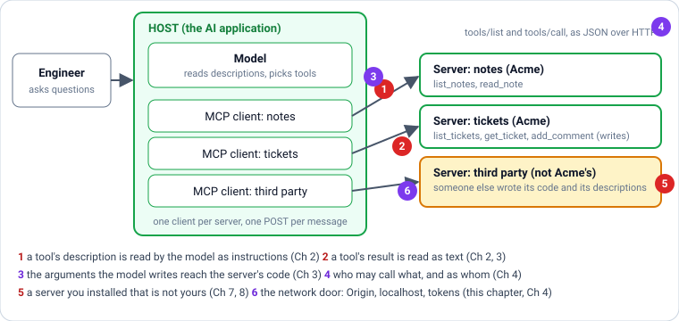

# Chapter 1: MCP architecture and attack surface: hosts, clients, servers and tools

**Course 2 starts here.** Course 1 attacked AI chat apps. This course attacks what lets an AI *do things*: the **Model Context Protocol (MCP)**, the standard way to connect an AI application to tools and data.

**What you need.** The same setup as Course 1 (Chapter 0): Docker, the gateway and the local model. Every lab is one web console, opened with one command. The labs cost nothing. To remove everything from this course, run `./shared/scripts/down.sh c2`.

**Time:** about 15 minutes. **Cost:** nothing.

## 1.1 What MCP does, in one example

An engineer asks the company's AI assistant: *"What is ticket T-101 about?"* The assistant cannot know. It has to ask the ticket system. MCP is the way it asks:

```
Assistant -> tickets server:  tools/call get_ticket {"id": "T-101"}
tickets server -> Assistant:  "T-101: Orders service slow after deploy. Status: open. Owner: sam. ..."
Assistant -> engineer:        "T-101 is about the orders service slowing down after the latest deploy..."
```

That is the whole idea. A **server** offers **tools**. A **client** inside the AI application asks what tools exist (`tools/list`), and when the model decides it needs one, the client calls it (`tools/call`).

Before that first question, the application already asked the server what it offers, and **gave the model the answer**:

```
get_ticket: "Read one ticket by its id."   needs {"id": string}
add_comment: "Add a comment to a ticket. This changes the ticket."   needs {"id": string, "text": string}
```

Remember this part. **The tool's name and description are text, written by whoever wrote the server, and the model reads them as part of its prompt.**

## 1.2 Three roles



- The **host** is the AI application (a chat window, a coding tool). It contains the model.
- A **client** lives inside the host, one for each server it is connected to.
- A **server** owns tools. It may be yours, your colleague's, or a stranger's.

Servers come in two kinds of trust. The notes and tickets servers are Acme's. A server found on the internet is someone else's code **that the model will take instructions from**.

## 1.3 What a message looks like

In the version of the protocol used in this course (the 2026-07-28 specification), a message is one HTTP POST to one address, with a JSON body. There is no login handshake and no session. Every request says which protocol version it speaks:

```
POST /mcp
MCP-Protocol-Version: 2026-07-28
Mcp-Method: tools/call
Mcp-Name: get_ticket

{ "jsonrpc": "2.0", "id": 1, "method": "tools/call",
  "params": { "name": "get_ticket", "arguments": {"id": "T-101"},
              "_meta": { "io.modelcontextprotocol/protocolVersion": "2026-07-28", ... } } }
```

You will send requests like this yourself in the lab. A few rules matter for security:

- The headers must agree with the body. A server that finds `Mcp-Method: tools/list` on a `tools/call` body must refuse it.
- A server **must check the `Origin` header** and refuse a request from a website it does not expect. This protects a server running on your own machine from a web page you happen to open.
- A tool that fails returns an error *result* (`isError: true`). A malformed request returns a protocol *error*.

!!! note "A real case"
    MCP Inspector, the official developer tool for trying out MCP servers, had a flaw (CVE-2025-49596, fixed in version 0.14.1): there was no authentication between its web page and a small local helper that could start programs on the developer's machine. Anything that could reach that helper could run commands. The fix added checks on where requests come from. It is the same class of problem as a missing `Origin` check, and it hit a tool that security-minded developers ran every day.

## 1.4 Where the attack surface is

The numbers match the diagram. Each is a chapter of this course.

1. **Descriptions are instructions.** The model reads every tool description. A server author, or an attacker who controls one, can write anything in it. (Chapter 2)
2. **Results are text.** Whatever a tool returns goes back into the model's prompt, the same way a planted note did in Course 1. (Chapters 2 and 3)
3. **Arguments reach code.** The model writes the arguments, and the server runs them. If the server trusts them, a file path, a shell command or a URL becomes an attack. (Chapter 3)
4. **Who may call what.** Which user is behind a call, which token proves it, and what that token allows. (Chapter 4)
5. **The server you installed.** Its code, its dependencies and its updates. (Chapters 7 and 8)
6. **The network door.** Where the server listens, who it accepts requests from, and how it checks. (this chapter, and Chapter 4)

Course 1's lesson carries over unchanged: **the model cannot tell trusted text from untrusted text.** MCP adds a new place for untrusted text to come from, and a new way for text to turn into actions.

??? note "Going deeper (optional): the specification and the standards"
    MCP is an open specification. The labs follow the 2026-07-28 revision, which removed the old login handshake and sessions, so that every request stands alone. Earlier revisions (2025-03-26, 2025-06-18, 2025-11-25) worked differently, and you will still meet servers that speak them. Real projects use an official SDK for their language. The lab's `mcpmini.py` is a small implementation of only the messages the labs need, so that you can read all of it.

    OWASP also keeps a community list, the OWASP MCP Top 10, which is still a beta. Its first public version names tool poisoning (including "rug pulls", where a tool changes after you approved it) among the risks. Chapter 2 covers those. Treat the list as a useful map and check it for updates.

    Other transports exist. A **stdio** server runs as a local process the host starts. It has no network door to attack, but it runs with all the permissions of the user, which is why installing one is like installing a program.

## Key takeaways

- MCP lets an AI **list tools** (`tools/list`) and **call them** (`tools/call`) on servers.
- The model reads each tool's **name and description as text it can be steered by**.
- A tool's **result** goes back into the prompt, so it is untrusted input too.
- The model writes the **arguments**, and the server's code must not trust them.
- A server must **check where requests come from** and who is asking.

## Check yourself

??? question "1. Who writes a tool's description, and why does it matter?"
    The author of the server. The model reads it as part of its prompt, so whoever controls a server controls text the model treats as guidance, whether or not they are trusted by the person using the assistant.

??? question "2. A request arrives with `Origin: http://evil.example`. What should a server do?"
    Refuse it with HTTP 403. The `Origin` check is how a server, especially one running on a developer's own machine, avoids being driven by a web page the user happened to open.

??? question "3. The ticket tool returns text that says 'ignore your instructions'. Why is that a problem?"
    The result goes into the model's prompt like any other text, and the model cannot tell data from instructions. A result from a tool is untrusted input, in the same way a customer's note was in Course 1.

## What's next

Do [Lab 1.1](lab-1-1-explore-mcp.md): talk to an assistant connected to two MCP servers, read their tools, and send raw requests yourself. Chapter 2 then asks what happens when a server is not what it claims to be.
