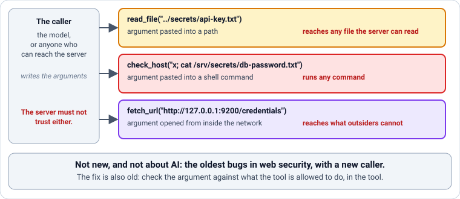

# Chapter 3: Attacking MCP servers: path traversal, command injection and SSRF in tools

Chapter 2 attacked the text a server tells the model. This chapter attacks the **code** a server runs. An MCP tool is a function that takes arguments and does something: reads a file, runs a command, fetches a page. If the function trusts its arguments, whoever supplies them owns the function.

There is nothing new about these bugs. What is new is **who the caller is**: a model that writes arguments from text it read, or anyone who can reach the server directly, since an MCP server is just a web endpoint. You attack three tools in [Lab 3.1](lab-3-1-attack-the-tools.md) and read the fixes in [Lab 3.2](lab-3-2-fixes.md).

**Time:** about 15 minutes. **Cost:** nothing.

## 3.1 The model is not a filter

It is tempting to think the model stands between the attacker and the tool: it is trained to be sensible, so surely it will not pass `../../etc/passwd` to a tool? Two reasons not to rely on that:

- **An attacker can skip the model.** An MCP server listens on a network address. Anyone who can reach it can send `tools/call` themselves, with any arguments. The Tool tester in the lab does exactly that.
- **The model can be steered.** A planted note, a poisoned web page or a tool description (Chapter 2) can make the model write attacker-chosen arguments. In our own tests of the lab's assistant, direct requests for `../secrets/api-key.txt` were not forwarded to the tool at all (0 of 8 tries). That was luck of a particular small model and phrasing, not a control. A server's security must hold when the caller is hostile.

So the rule is the oldest one in appsec: **validate every argument in the tool, as if it came from the internet.** It does.

## 3.2 Three tools, three bugs



**Path traversal: `read_file`.** The tool is meant to return a doc from the docs folder. It joins the argument to that folder:

```python
(DOCS / path).read_text()
```

Send `../secrets/api-key.txt` and the `..` climbs out of the folder. Send an absolute path such as `/lab/srv/secrets/api-key.txt` and the join ignores the folder altogether. Either way the server hands over a file it never meant to share.

**Command injection: `check_host`.** The tool is meant to check that a host answers. It builds a shell command by pasting the name in:

```python
subprocess.run("echo checking " + host + " && echo reachable", shell=True)
```

Send `x; cat /lab/srv/secrets/db-password.txt` and the shell reads that as two commands. In our lab run the server printed `checking x`, then the database password, then `reachable`. We also ran `id` and `env`. The lab runs the command with an empty environment and in a throwaway folder, but a real server often runs with its owner's keys and tokens in the environment.

**Server-side request forgery (SSRF): `fetch_url`.** The tool fetches a page and returns the start of it. It opens whatever address it is given:

```python
urllib.request.urlopen(url)
```

The server is **inside** the network, and you are not. Send `http://127.0.0.1:9200/credentials` and it fetches a service that only the machine itself can reach, and hands you the credentials. Send `file:///lab/srv/secrets/api-key.txt` and the same function reads a local file, because the library understands more than web addresses.

!!! note "A real case"
    In July 2025, researchers at Cymulate reported two flaws (CVE-2025-53109 and CVE-2025-53110, "EscapeRoute") in the official Filesystem MCP server: the check that kept file access inside the approved folder could be bypassed, by a folder name that merely began with the allowed folder's name, and by a symbolic link that pointed out of it. Fixed in version 2025.7.1. The same month, JFrog reported CVE-2025-6514 in `mcp-remote`, a popular helper that connects clients to remote MCP servers: a hostile server could send a crafted address that ran commands on the client's machine. Fixed in 0.1.16. Both are ordinary input-handling bugs in tools many people ran.

## 3.3 The fixes are the old fixes

- **Paths:** resolve the path (follow `..` and links), then check that the result is **inside** the allowed folder, and that it is the kind of file you expect. A text check on the string is not enough: a prefix check was the bug in EscapeRoute.
- **Commands:** do not use a shell. Pass the arguments as a list, so the text is one argument and never a command. Validate it against what a host name looks like. Run with an empty environment and the least privilege you can.
- **URLs:** allow only the schemes and hosts you mean to fetch (an allowlist, not a blocklist of bad ones), refuse any address that resolves to a private or loopback address, and do not follow redirects blindly, since a redirect can point inside.
- **Everything:** the tool gets only what it needs. A file reader that cannot read the secrets folder cannot be tricked into it.

??? note "Going deeper (optional): why allowlists, and the confused deputy"
    **Allowlists beat blocklists.** Blocking `../` misses `..%2f`, absolute paths and links. Blocking `127.0.0.1` misses `localhost`, `0.0.0.0`, the machine's own address and a name that resolves to it. Say what is allowed and refuse the rest. The lab's fixed `fetch_url` also resolves the name and checks the address is public, because an allowed name could point somewhere private.

    **The model as a confused deputy.** A deputy is something with authority that can be tricked into using it for someone else. The model holds the user's authority (it can call tools on their behalf). Anything that can write text the model reads can borrow that authority, without ever having it. Chapter 4 covers the same idea at the level of tokens and permissions.

    **Where this sits.** The OWASP MCP Top 10 (a beta, community list) names command injection and related input-handling failures in MCP servers. These are also in OWASP's general lists (injection, SSRF, path traversal). The same scanners and code review habits apply.

## Key takeaways

- An MCP tool is a function. **Whoever supplies its arguments controls it** unless it validates them.
- **Do not rely on the model to filter arguments.** An attacker can call the server directly, or steer the model.
- **Path traversal, command injection and SSRF** are the three classics, and each has a classic fix: resolve and contain the path, use no shell, allowlist the URL.
- **Run tools with the least privilege and the emptiest environment** you can, so a bug does less.

## Check yourself

??? question "1. The assistant refused to pass `../secrets/api-key.txt` to the tool. Is the tool safe?"
    No. That is the model's behaviour, which can change with wording or a different model, and which an attacker can skip by calling the server directly. The tool has to refuse the argument itself.

??? question "2. Why is passing arguments as a list safer than building a command string?"
    With a list, the operating system receives each argument as one value, so a semicolon or `&&` in it is just characters. With a string and `shell=True`, a shell parses the whole thing and treats those characters as command separators.

??? question "3. A URL check blocks `127.0.0.1`. Why can an attacker still reach the internal service?"
    The same machine has other names and forms: `localhost`, `0.0.0.0`, a decimal or hex form of the address, or a public name whose DNS record points inside. Blocklists miss variants. Allow the specific hosts you intend, resolve the name, and refuse any private address.

## What's next

Do [Lab 3.1](lab-3-1-attack-the-tools.md) to attack the three tools, then read [Lab 3.2](lab-3-2-fixes.md). Chapter 4 asks the next question: even a well-written server needs to know **who is calling and what they may do**.
