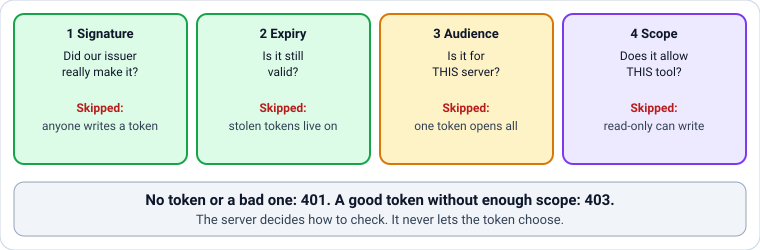

# Chapter 4: MCP authentication and authorization: tokens, audience, scopes and who may do what

A server that anyone can call is a server that does what anyone says. This chapter is about the two questions every MCP server must answer for every request: **who is calling** (authentication) and **what may they do** (authorization). You attack three mistakes in [Lab 4.1](lab-4-1-break-the-token-checks.md) and read the fixes in [Lab 4.2](lab-4-2-fixes.md).

**Time:** about 15 minutes. **Cost:** nothing.

## 4.1 The token, in one example

Sam is a read-only engineer. To call the tickets server, Sam's assistant sends a **bearer token**: a signed note from an authorization server that says who Sam is and what the note is good for.

```
Authorization: Bearer eyJhbGciOi...   (three parts: header . payload . signature)

payload = { "iss": "https://auth.acme.example",   who issued it
            "sub": "sam",                           who it is about
            "aud": "tickets",                       which server it is FOR
            "scope": "tickets:read",                what it allows
            "exp": 1795372000 }                     when it stops working
```

A server must check **every** part before it acts:

| Check | Question | If skipped |
|---|---|---|
| **Signature** | Did the authorization server really issue this? | Anyone can write a token |
| **Expiry** | Is it still valid? | A stolen token works forever |
| **Audience** | Was it issued for *this* server? | A token for one server works on all of them |
| **Scope** | Does it allow *this tool*? | A read-only token can write |

The MCP specification asks servers to do this. A server must validate that a token was issued **for it**, must accept only tokens valid for its own resources, and must not accept or pass on any other tokens. It answers **401** when the token is missing, bad or expired, and **403** when the token is fine but the scope is not enough, with a header that says where to find the rules (`WWW-Authenticate` pointing at its protected-resource metadata).

## 4.2 Three mistakes, all common

**No audience check.** The tickets server checks the signature and expiry, and never compares `aud` with itself. A token minted for the *notes* server works on tickets. In the lab, the tickets server answered 200 to a notes token. Why it matters: servers differ in power. A token that is safe to hand to a low-value server becomes a key to a high-value one. This is also why a server must **never pass the client's token on** to another service: the next service cannot tell the token was meant for someone else (the "token passthrough" problem).

**No scope check.** Sam's token says `tickets:read`. The `add_comment` tool changes a ticket. As shipped, the server never looks at the scope before running it, so Sam's read-only token wrote a comment.

**Trusting the token's own claim about itself.** A token header says how it was signed. A server that honours `"alg": "none"` (not signed) lets the attacker pick the check. Anyone writes `{"alg":"none"}`, any claims they like, and an empty signature. In the lab the server accepted it. The fix is to **decide the algorithm on the server** and never read it from the token.



!!! note "About the confused deputy"
    A *deputy* is a program with authority that can be tricked into using it for someone else. An MCP server that holds a powerful credential and acts for any caller is one. The defences are the checks above plus **per-user tokens**: the server acts with the caller's permissions, not its own.

## 4.3 Where the model comes in

In Chapter 2 and 3 the attacker reached the tools through text. Authorization is where you contain the damage: even if a poisoned description or a planted note steers the assistant, the token it holds limits what the call can do. So:

- Give each token the **least scope** the task needs, and a short lifetime.
- One token **per server** (audience). Never reuse.
- Writes need a scope that read-only users do not have.
- Keep tokens out of prompts, tool arguments and logs. The lab's tester masks them.

??? note "Going deeper (optional): the 2026-07-28 authorization rules"
    Clients must send the `resource` parameter (RFC 8707) so the issuer binds the token to one server. They must validate the issuer (`iss`, RFC 9207) on the authorization response to prevent mix-up attacks. Servers publish OAuth Protected Resource Metadata (RFC 9728) so clients can find the authorization server. Dynamic Client Registration (RFC 7591) is deprecated in favour of Client ID Metadata Documents. Tokens never go in the URL query string.

    The lab's tokens are a hand-built, tiny JWT-style format so you can see all of it. Real systems use a standard OAuth 2.1 flow and a tested library for token validation. Never write your own in production.

## Key takeaways

- Every request needs **authentication** (who) and **authorization** (what).
- Check the **signature, expiry, audience and scope**, in that order. Skip one and that attack is open.
- **401** means no valid token. **403** means a valid token without enough scope.
- Never let a token choose how it is checked (`alg: none`), and never **pass a token on** to another service.
- Scopes and audiences **limit the blast radius** when a prompt-level attack succeeds.

## Check yourself

??? question "1. A token for the notes server is accepted by the tickets server. What check is missing, and why does it matter?"
    The audience check. Without it every token is a master key to every server that trusts the same issuer, so a low-value server's token unlocks a high-value one.

??? question "2. Why must the server, not the token, decide the signing algorithm?"
    The token is written by the caller. If the server obeys the header, an attacker writes `none` and the server skips verification. The server must expect one algorithm and reject anything else.

??? question "3. Sam's token is valid but only has `tickets:read`, and Sam calls `add_comment`. 401 or 403?"
    403. The caller is authenticated, but not allowed. 401 is for a missing, invalid or expired token.

## What's next

Do [Lab 4.1](lab-4-1-break-the-token-checks.md), then [Lab 4.2](lab-4-2-fixes.md). Chapter 5 puts the whole course together as a threat model for an MCP deployment.
