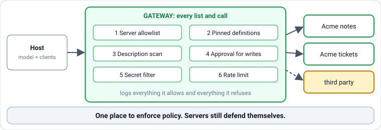

# Chapter 6: Defending MCP with a gateway: allowlists, pinning, approval, egress and limits

Chapter 5 gave you a register of threats. This chapter builds the controls. The idea is one place that **every tool listing and every tool call must pass through**: a **gateway** between the assistant and its servers. It enforces rules the servers cannot be trusted to enforce, and it is where you measure whether the rules work.

You switch controls on and run an attack suite in [Lab 6.1](lab-6-1-build-the-defence.md), and read what each control cannot do in [Lab 6.2](lab-6-2-limits-of-each-control.md).

**Time:** about 15 minutes. **Cost:** nothing.

## 6.1 Six controls, one gateway

| Control | What it does | Stops |
|---|---|---|
| **Server allowlist** | Only servers Acme chose are connected | A stranger's server offering poisoned tools; secrets sent to it |
| **Pin approved definitions** | A tool is offered only if its name, description and schema match the hash approved | Rug pulls |
| **Scan third-party descriptions** | Hide descriptions that read like orders to the model | The lazy poisoned descriptions |
| **Approval for writes** | A tool that changes things needs a person's approval | Shadowing and poisoning doing damage |
| **Block secrets in arguments** | Refuse calls whose arguments look like keys | Simple data leaks |
| **Rate limit** | A cap on calls per task | Runaway loops and cost |

Each is a few lines. In the lab they are switches, and the suite below measures what each one buys.

## 6.2 Measure, as in Course 1

The lab suite runs five attacks and three pieces of real work. With **no controls**, all five attacks work, and all three tasks do too. That is the baseline. With **everything denied**, no attack works, and no task does either. That is the trap from Course 1, Chapter 8: a control that blocks everything looks perfect on the first number.

The honest goal is **all five attacks stopped and all three tasks working**, with as few controls as possible. In the lab, three controls do it: the allowlist, approval for writes and the rate limit. Other combinations work too, and each pair of controls overlaps. That overlap is **defence in depth**: if the scan misses a reworded description, the allowlist or the approval still stands.

## 6.3 What a gateway cannot do

- It cannot stop a **model being fooled**. It limits what a fooled model can do.
- It only controls **traffic that goes through it**. A server that can be called directly must still validate its own inputs (Chapters 3 and 4).
- A **scan** is a filter. A reworded attack passes it.
- An **approval** is only as good as what the person sees. It must show the exact arguments, not just a tool name.
- A **secret filter** finds only the shapes it knows.

??? note "Going deeper (optional): where to put it, and what real gateways add"
    A gateway can run beside the host (one per assistant), as a shared service (one for the company) or inside the host itself. A shared one gives you one place for logs, rate limits and approvals. Real MCP gateways also handle authentication and token exchange (Chapter 4), audit logging, per-user policy and caching of tool lists, which the specification lets servers mark with a lifetime (`ttlMs`).

    Treat the gateway as a security product: keep it small, test it with the attack suite on every change, and run it with the least privilege you can. A bug in the gateway is a bug in every server behind it.

## Key takeaways

- A **gateway** is one place every list and call passes through, so policy is enforced once.
- Six useful controls: **allowlist, pin, scan, approval for writes, secret filter, rate limit**.
- **Measure two numbers**: attacks stopped and work still done. Denying everything scores perfectly on the first and fails the second.
- Controls **overlap on purpose**. No single one is enough.
- A gateway **limits** a fooled model. Servers still defend themselves.

## Check yourself

??? question "1. A policy denies every call. The attack suite shows 5 of 5 attacks stopped. Is it good?"
    No. Real work stops too. Look at both numbers: attacks stopped and tasks still working.

??? question "2. Pinning stops the rug pull but not a description that was hostile when approved. Why?"
    The hash only proves the description is the same as the approved one. If the approved text was already hostile, the match is perfect. Review at approval, a scan and the allowlist cover that case.

??? question "3. Why do writes need approval even with a good scan?"
    The scan is a filter and can be bypassed by rewording. Approval does not depend on recognising the attack: whatever fooled the model, the write still waits for a person.

## What's next

Do [Lab 6.1](lab-6-1-build-the-defence.md), then read [Lab 6.2](lab-6-2-limits-of-each-control.md). Chapter 7 puts these checks into the build pipeline, so a bad server never reaches the gateway.
